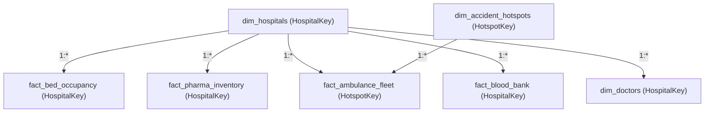

# TechHunters Smart Hospital & Emergency Response System
## Power BI Dashboard Architecture & Modeling Guide

This guide describes how to connect **Power BI Desktop** to the data produced by the Smart Hospital Optimization & Emergency Response System.

---

### 1. Data Sources

All Power BI-ready star-schema tables are generated inside the `dashboard/data/` folder:

| File | Type | Description |
|---|---|---|
| `dim_hospitals.csv` | Dimension | Hospital key, name, city, state, coordinates, total beds, ventilators |
| `dim_doctors.csv` | Dimension | Doctor key, name, hospital, specialization, experience, on-duty status |
| `dim_accident_hotspots.csv` | Dimension | Hotspot key, corridor name, city, risk level, annual accidents, fatalities |
| `fact_bed_occupancy.csv` | Fact | Ward type (General, ICU, Emergency), total, occupied, free, occupancy rate % |
| `fact_pharma_inventory.csv` | Fact | Drug name, category, distributor, quantity, expiry days, status, sales |
| `fact_ambulance_fleet.csv` | Fact | Ambulance code, vehicle type, status (free/busy), location, staging post |
| `fact_blood_bank.csv` | Fact | Hospital blood units by blood group (A+, B+, O+, AB+, etc.) |

---

### 2. Star Schema Data Model Relationships

In **Power BI Model View**, configure the following one-to-many (`1:*`) relationships:



---

### 3. Core DAX Measures

Create a dedicated **Measures Table** in Power BI with these standard DAX formulas:

#### A. Bed Management Measures
```dax
Total Beds = SUM(fact_bed_occupancy[total_beds])

Occupied Beds = SUM(fact_bed_occupancy[occupied_beds])

Free Beds = SUM(fact_bed_occupancy[free_beds])

Bed Occupancy Rate % = 
DIVIDE([Occupied Beds], [Total Beds], 0) * 100

ICU Bed Occupancy % = 
DIVIDE(
    CALCULATE([Occupied Beds], fact_bed_occupancy[ward_type] = "ICU"),
    CALCULATE([Total Beds], fact_bed_occupancy[ward_type] = "ICU"),
    0
) * 100

Critical Shortage Wards Count = 
CALCULATE(
    COUNTROWS(fact_bed_occupancy),
    fact_bed_occupancy[free_beds] <= 4
)
```

#### B. Medicine & Inventory Measures
```dax
Total Inventory Units = SUM(fact_pharma_inventory[quantity])

Total Expired Batches = 
CALCULATE(
    COUNTROWS(fact_pharma_inventory),
    fact_pharma_inventory[stock_status] = "EXPIRED"
)

Near Expiry Batches (<=30 Days) = 
CALCULATE(
    COUNTROWS(fact_pharma_inventory),
    fact_pharma_inventory[stock_status] = "NEAR_EXPIRY"
)

Critical Stockout Alerts = 
CALCULATE(
    COUNTROWS(fact_pharma_inventory),
    fact_pharma_inventory[quantity] < 50
)

Inventory Valuation = 
SUMX(fact_pharma_inventory, fact_pharma_inventory[quantity] * fact_pharma_inventory[unit_price])
```

#### C. Ambulance Fleet & Emergency Response Measures
```dax
Total Ambulance Fleet = COUNTROWS(fact_ambulance_fleet)

Available Ambulances = 
CALCULATE(
    COUNTROWS(fact_ambulance_fleet),
    fact_ambulance_fleet[fleet_status] = "free",
    fact_ambulance_fleet[in_service] = 1
)

Fleet Availability Rate % = 
DIVIDE([Available Ambulances], [Total Ambulance Fleet], 0) * 100

Hotspot Staged Ambulances = 
CALCULATE(
    COUNTROWS(fact_ambulance_fleet),
    NOT(ISBLANK(fact_ambulance_fleet[HotspotKey]))
)
```

#### D. Accident Hotspots & Corridor Safety Measures
```dax
Total High-Risk Corridors = COUNTROWS(dim_accident_hotspots)

Total Annual Accidents = SUM(dim_accident_hotspots[annual_accidents])

Total Fatalities = SUM(dim_accident_hotspots[fatalities])

Corridor Fatality Ratio % = 
DIVIDE([Total Fatalities], [Total Annual Accidents], 0) * 100
```

---

### 4. Recommended Power BI Report Pages

1. **Executive Command Center (Page 1)**:
   - KPI Cards: Total Beds, Occupancy Rate %, Active Fleet, Expired Stock Batches, Critical Hotspots
   - Map Visual: Latitude & Longitude from `dim_hospitals` and `dim_accident_hotspots`
   - Slicer by City (`Mumbai`, `New Delhi`, `Bangalore`, `Hyderabad`, `Chennai`, `Ahmedabad`, `Kochi`, `Noida`)

2. **Ward & Bed Analytics (Page 2)**:
   - Clustered Bar Chart: Total vs Occupied beds by Ward Type (General, ICU, Emergency)
   - Table Visual: Hospitals filtered to `free_beds <= 4` (Low-availability alert matrix)
   - Gauge: Overall Bed Occupancy % with target threshold at 85%

3. **Pharmacy & Supply Chain Intelligence (Page 3)**:
   - Donut Chart: Inventory breakdown by Stock Status (Adequate, Low Stock, Near Expiry, Expired)
   - Treemap: Inventory value by Drug Category (Injection, Syrup, Tablet, Capsule)
   - Matrix Table: Distributor performance and stock days left

4. **108 Emergency Response & Corridor Staging (Page 4)**:
   - Hotspot Risk Matrix: Fatalities vs Accidents by Highway Corridor
   - Donut Chart: Ambulance Readiness (Free vs Busy vs Maintenance)
   - Staging Coverage Table: Proximity of 108 ALS ambulances to Critical Hotspots
